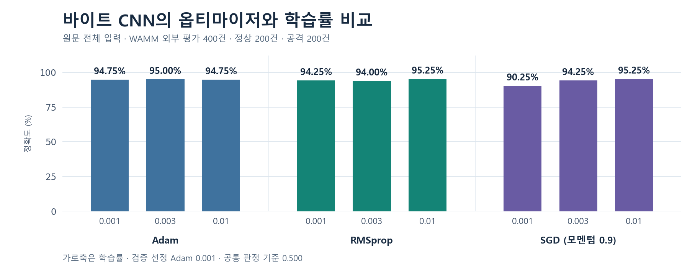

# AI 기반 웹 침입 탐지·로그 분석

웹 요청에 공격 점수를 매기고, 관리 화면에서 의심 로그의 입력 원문을 조회하는 프로젝트입니다. 저는 학부 과제에서 CNN 모델 구조와 학습 코드를 맡았고, Flask 분석 API와 MySQL 로그 조회를 JavaScript 화면에 연결했습니다.

## SQL 인젝션 탐지

요청 문자열을 UTF-8 바이트 배열로 바꿔 문자와 기호의 순서를 보존합니다. 각 바이트 번호에 1을 더하고, 배치 안에서 길이가 짧은 입력은 뒤에 0을 채웁니다. 임베딩을 거쳐 1차원 합성곱 두 층이 가까운 바이트의 패턴을 찾습니다. 전역 최대 풀링과 분류층을 거쳐 공격 점수 하나를 냅니다. 검증 데이터에서 고른 기준 0.500 이상을 공격으로 판정했습니다.

| 분할 | 건수 | 정확도 | 정상 오탐 | 공격 미탐 |
| --- | ---: | ---: | ---: | ---: |
| 학습 | 16,368 | 99.95% | 5 | 4 |
| 검증 | 5,467 | 99.89% | 4 | 2 |
| HttpParamsDataset 내부 평가 | 5,084 | 100.00% | 0 | 0 |
| WAMM 외부 평가 | 400 | 94.75% | 1 | 20 |


학습·검증에는 HttpParamsDataset과 Mendeley를 사용했습니다. 학습 16,368건은 HttpParamsDataset 15,168건과 Mendeley 1,200건을 합친 표본 수입니다. 검증 5,467건은 두 출처의 5,067건과 400건을 합친 표본 수입니다.

## 화면 열기

Python 3.12 환경에서 실행합니다.

```bash
python -m pip install -r requirements.txt
python app.py
```

브라우저에서 `http://127.0.0.1:8000`을 열고 요청 값을 입력합니다. 점수는 `/ai`에서 확인할 수 있고, 화면에서 제출한 요청은 로컬 SQLite에 저장됩니다. 로그 화면은 저장 모델에 기록된 판정 기준을 넘거나 같은 요청을 위험 목록에 올리고, 로그를 선택하면 입력 원문을 보여줍니다. 학부 시연은 PHP와 MySQL을 사용했고, 이 저장소의 로컬 데모는 Flask와 SQLite로 동작합니다.

## 학습과 평가

[HttpParamsDataset](https://github.com/Morzeux/HttpParamsDataset)을 템플릿 단위로 학습·검증·내부 평가로 나눴습니다. [Mendeley Normal & Malicious SQLi](https://data.mendeley.com/datasets/sx84kj3xfz/1)에서는 학습 1,200건과 검증 400건을 사용했습니다. 매 회차에는 HttpParamsDataset 학습 15,168건과 Mendeley 학습 분할에서 복원추출한 3,792건을 섞었습니다.

| 파일 | 필요한 열 |
| --- | --- |
| `HttpParamsDataset.csv` | `text`, `label`, `group`, `split` |
| `Mendeley_SQLi.csv` | `id`, `text`, `label`, `group` |
| `외부_분할.csv` | `id`, `split` |
| `WAMM_v2_evaluation.csv` | `id`, `text`, `label` |

`label`의 0은 정상, 1은 공격입니다. 학습 스크립트는 위 목록의 처음 세 파일을 사용합니다. [prepare_http.py](prepare_http.py)는 HttpParamsDataset 원본에서 분할을 생성할 때 쓰는 코드를 담고 있습니다. 분할 CSV의 해시는 [모델 선택 기록](models/byte_selection.json)에 있습니다.

```bash
python train.py --data-dir data --output-dir runs/byte_cnn
python evaluate.py --data-dir data --external-csv data/WAMM_v2_evaluation.csv
```

### 외부 평가 표본

[WAMM DS-Augmented-v2](https://github.com/CyShield-Security-R-D/WAMM-Dataset-Repository/tree/2783eab560c4355f5976a57fc2e97a2e6c5c79a1)에서 정상과 SQL 인젝션으로 라벨된 GET 요청 중 비어 있지 않은 쿼리 파라미터가 하나인 요청을 사용했습니다. 값을 디코딩해 그대로 입력했습니다. 기존 데이터와 동일한 원문·템플릿을 제외하고 템플릿마다 하나씩, 정상 200건과 공격 200건을 정해진 해시 순서로 골랐습니다. 정답은 WAMM의 요청 수준 라벨입니다. 이 결과는 선택 조건에 해당하는 HTTP 요청에 대한 평가입니다.

공개 `DS_Augmented_v2.db.xz`를 `DS_Augmented_v2.db`로 압축 해제한 다음 표본을 준비합니다. WAMM 출처, CC BY 4.0 라이선스, DOI와 평가 CSV 해시는 [비교 기록](reports/optimizer_settings.json)에 있습니다.

```bash
python prepare_wamm.py DS_Augmented_v2.db --data-dir data --output data/WAMM_v2_evaluation.csv
```

### 옵티마이저와 학습률 비교

원문 전체, 배치 크기 128, 학습 6회 조건에서 Adam·RMSprop·SGD(모멘텀 0.9)와 학습률 0.001·0.003·0.01을 비교했습니다. 두 검증 분할의 평균 균형 정확도를 먼저 보고, 동률일 때 평균 공격 재현율과 검증 로그 손실을 비교했습니다. 최종 모델은 Adam 0.001의 2회차 가중치입니다.



```bash
python compare.py --data-dir data --output-dir runs/optimizer_settings --external-csv data/WAMM_v2_evaluation.csv
```

### 판정 기준

두 검증 분할의 점수에서 0.000~1.000을 0.001 간격으로 비교했습니다. 평균 균형 정확도가 가장 높고, 동률이면 평균 공격 재현율이 높거나 0.5에 가까운 값 0.500을 선택했습니다. 모델과 기준을 확정한 뒤 외부 평가에 적용했습니다.

```bash
python evaluate.py --data-dir data --validation-csv runs/validation_scores.csv
python tune_threshold.py runs/validation_scores.csv --output runs/threshold_selection.json
python evaluate.py --data-dir data --scores-dir runs/scores
```

## 파일 구성

| 파일 | 내용 |
| --- | --- |
| [detector.py](detector.py) · [models](models/) | 바이트 입력 변환, 추론, 저장 모델 |
| [train.py](train.py) · [evaluate.py](evaluate.py) · [compare.py](compare.py) | 학습, 검증, 공개 표본 평가와 설정 비교 |
| [app.py](app.py) · [web](web/) | 로컬 웹 데모와 로그 저장·조회 |
