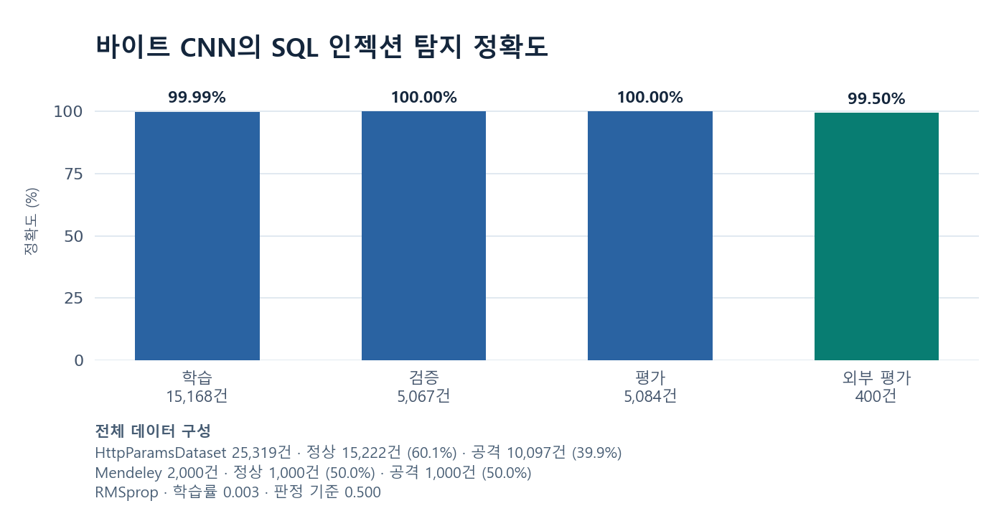
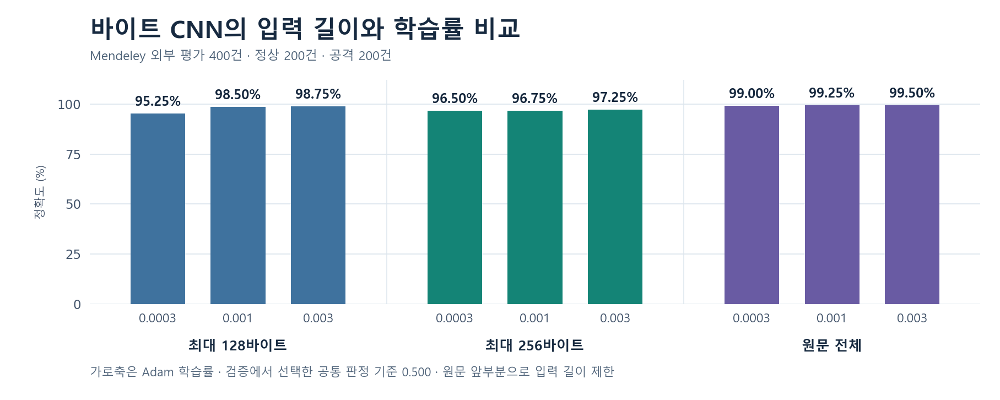

# AI 기반 웹 침입 탐지·로그 분석

웹 요청에 공격 점수를 매기고, 관리 화면에서 의심 로그의 입력 원문을 조회하는 프로젝트입니다. 저는 학부 과제에서 CNN 모델 구조와 학습 코드를 맡았고, Flask 분석 API와 MySQL 로그 조회를 JavaScript 화면에 연결했습니다.

## SQL 인젝션 탐지

요청 문자열을 UTF-8 바이트 배열로 바꿔 문자와 기호의 순서를 보존합니다. 각 바이트 번호에 1을 더하고, 배치 안에서 길이가 짧은 입력은 뒤에 0을 채웁니다. 임베딩을 거쳐 1차원 합성곱 두 층이 가까운 바이트의 패턴을 찾습니다. 전역 최대 풀링과 분류층을 거쳐 공격 점수 하나를 냅니다. 검증 데이터에서 고른 기준 0.500 이상을 공격으로 판정했습니다.

| 분할 | 건수 | 정확도 | 정상 오탐 | 공격 미탐 |
| --- | ---: | ---: | ---: | ---: |
| HttpParamsDataset 학습 | 15,168 | 99.97% | 1 | 3 |
| HttpParamsDataset 검증 | 5,067 | 99.98% | 0 | 1 |
| HttpParamsDataset 평가 | 5,084 | 100.00% | 0 | 0 |
| Mendeley 외부 평가 | 400 | 99.25% | 1 | 2 |



HttpParamsDataset은 비슷한 요청을 템플릿 단위로 묶고, 정상 약 60%와 공격 약 40%의 비율이 각 분할에 가깝게 유지되도록 나눴습니다. Mendeley는 학습·검증·평가 분할마다 정상과 공격을 50%씩 사용했습니다. 위 학습 행은 저장 모델을 학습 분할에 다시 적용한 값입니다.

## 화면 열기

Python 3.12 환경에서 실행합니다.

```bash
python -m pip install -r requirements.txt
python app.py
```

브라우저에서 `http://127.0.0.1:8000`을 열고 요청 값을 입력합니다. 점수는 `/ai`에서 확인할 수 있고, 화면에서 제출한 요청은 로컬 SQLite에 저장됩니다. 로그 화면은 저장 모델에 기록된 판정 기준을 넘거나 같은 요청을 위험 목록에 올리고, 로그를 선택하면 입력 원문을 보여줍니다. 학부 시연은 PHP와 MySQL을 사용했고, 이 저장소의 로컬 데모는 Flask와 SQLite로 동작합니다.

## 학습과 평가

[HttpParamsDataset](https://github.com/Morzeux/HttpParamsDataset)과 [Mendeley Normal & Malicious SQLi](https://data.mendeley.com/datasets/sx84kj3xfz/1)를 사용했습니다. 저장 모델의 성능을 같은 조건에서 재현하려면 아래 분할 CSV 세 개가 필요합니다. 파일 해시는 [모델 선택 기록](models/byte_selection.json)에 있습니다.

| 파일 | 필요한 열 |
| --- | --- |
| `HttpParamsDataset.csv` | `text`, `label`, `group`, `split` |
| `Mendeley_SQLi.csv` | `id`, `text`, `label`, `group` |
| `외부_분할.csv` | `id`, `split` |

`label`의 0은 정상, 1은 공격입니다. HttpParamsDataset의 분할 값은 `train`, `validation`, `test`이고, Mendeley는 `train`, `validation`, `holdout`입니다. 분할 CSV는 별도로 준비합니다. [prepare_http.py](prepare_http.py)는 HttpParamsDataset 원본 CSV에서 개별 평가용 CSV를 만드는 데 쓸 수 있습니다.

```bash
python train.py --data-dir data --output-dir runs/byte_cnn
python evaluate.py --data-dir data
python evaluate.py --data-dir data --artifact-dir runs/byte_cnn
```

Adam 학습률 0.001, 배치 크기 128로 6회 학습하고, 두 검증 분할의 평균 균형 정확도로 2회차 가중치를 선택했습니다. [학습 기록](reports/training_history.json)과 [평가 결과](reports/evaluation.json)에 수치가 있습니다.

## 판정 기준

HttpParamsDataset과 Mendeley의 검증 점수에서 0.000~1.000을 0.001 간격으로 비교했습니다. 두 데이터셋의 균형 정확도 평균이 가장 큰 값을 선택했습니다. 동률이면 공격 재현율 평균이 높은 값, 그 값도 같으면 0.5에 가까운 값을 선택했습니다.

```bash
python evaluate.py --data-dir data --validation-csv runs/validation_scores.csv
python tune_threshold.py runs/validation_scores.csv --output runs/threshold_selection.json
python evaluate.py --data-dir data --scores-dir runs/scores
```

평가용 점수 CSV는 선택한 기준의 결과를 확인할 때 사용합니다. 점수 CSV에는 표본 ID, 정답, 점수, 판정 기준과 판정이 들어갑니다. [판정 기준 선택 결과](reports/threshold_selection.json)에 검증 비교를 기록했습니다.

### 입력 길이와 학습률 비교

입력은 앞 128바이트, 앞 256바이트, 원문 전체 세 가지로 두고, Adam 학습률 0.0003, 0.001, 0.003을 비교했습니다. 각 조합의 가중치는 검증에서 선택하고, 외부 평가에는 같은 Mendeley 홀드아웃 400건과 공통 판정 기준 0.500을 썼습니다.



원문 전체에서 학습률 0.003은 99.50%, 0.001은 99.25%였습니다. 검증에서는 두 조합의 평균 균형 정확도가 모두 99.36%였으며, 외부 평가에서는 400건 중 한 건 차이였습니다.

```bash
python compare.py --data-dir data --output-dir runs/input_settings
```

## 파일 구성

| 파일 | 내용 |
| --- | --- |
| [detector.py](detector.py) · [models](models/) | 바이트 입력 변환, 추론, 저장 모델 |
| [train.py](train.py) · [evaluate.py](evaluate.py) · [compare.py](compare.py) | 학습, 검증, 공개 표본 평가와 설정 비교 |
| [app.py](app.py) · [web](web/) | 로컬 웹 데모와 로그 저장·조회 |
